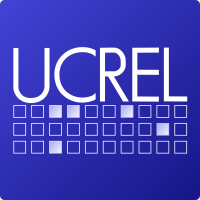
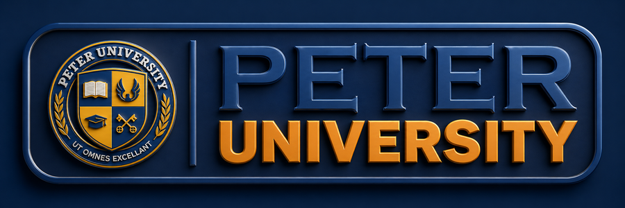
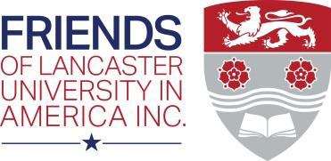

<p>
&nbsp;&nbsp;
&nbsp;&nbsp;
&nbsp;&nbsp;

</p>

# AI for Impact 2026: Language AI for Local Solutions

**Peter University, Achina-Onne, Anambra State, Nigeria · 30 November to 4 December 2026**


---

## Overview

This repository holds the programme, notebooks, data and slides for **AI for Impact 2026**, a free five-day hands-on workshop for 50 staff and students from Peter University and neighbouring institutions.

Across the week, mixed teams build a **bilingual community knowledge assistant**: a small tool that answers everyday questions from trusted local sources, in Igbo or English, and shows where each answer came from. No prior programming is required.

- Event website: https://ucrel.github.io/AI4Impact2026/
- A partnership between **Lancaster University** (UCREL, School of Computing and Communications) and **Peter University Achina-Onne**
- Funded by the **Friends of Lancaster University in America (FLUA)**

> Materials for each day are added to this repository at 07:00 West Africa Time on that day.

---

## How to use the notebooks

1. Click an **Open in Colab** badge in the programme below (you need a Google account).
2. Run each cell with **Shift + Enter**, top to bottom.
3. **Core** cells run anywhere, even offline. **Stretch** cells need internet and are optional.
4. No internet? Ask a facilitator for the offline copy (see [`offline/`](offline/)).

---

## Programme

### Day 1 · Monday 30 November 2026 · Foundations and gathering knowledge

| Time | Session | Lead |
| --- | --- | --- |
| 08:00 to 09:00 | Registration, Wi-Fi and Google account check, baseline survey | Local team |
| 09:00 to 09:45 | Opening ceremony | Vice-Chancellor; Dr Ignatius Ezeani |
| 09:45 to 10:30 | **Anchor talk:** Language AI for our languages | Dr Ignatius Ezeani |
| 11:00 to 13:00 | **Lab A:** Text as data · materials added on the day | Dr Ezeani, Dr Vidler |
| 14:00 to 15:30 | **Lab B, subtask 1 (Gather):** build the bilingual knowledge base | All mentors |
| 16:00 to 17:00 | Checkpoint and data ethics clinic | All mentors |

### Day 2 · Tuesday 1 December 2026 · Understanding the question

| Time | Session | Lead |
| --- | --- | --- |
| 09:00 to 10:00 | **Anchor talk:** How computers find meaning in text | Prof Paul Rayson |
| 10:30 to 12:30 | **Lab A:** Text classification · materials added on the day | Prof Rayson, Dr Ezeani |
| 13:30 to 15:30 | **Lab B, subtask 2 (Understand):** the question router | All mentors |
| 16:00 to 17:00 | Checkpoint | All mentors |

### Day 3 · Wednesday 2 December 2026 · Finding the key facts

| Time | Session | Lead |
| --- | --- | --- |
| 09:00 to 10:00 | **Anchor talk:** Igbo in the machine | Invited speaker |
| 10:30 to 12:30 | **Lab A:** Information extraction · materials added on the day | Prof Rayson, Dr Ezeani |
| 13:30 to 15:30 | **Lab B, subtask 3 (Extract):** glossary and fact cards | All mentors |
| 16:00 to 17:00 | Checkpoint | All mentors |

### Day 4 · Thursday 3 December 2026 · Answering the question

| Time | Session | Lead |
| --- | --- | --- |
| 09:00 to 10:00 | **Anchor talk:** AI that works where the internet does not | Dr John Vidler |
| 10:30 to 12:30 | **Lab A:** Search, prompting and retrieval · materials added on the day | Dr Vidler, Dr Ezeani |
| 13:30 to 15:30 | **Lab B, subtask 4 (Answer):** assemble the assistant | All mentors |
| 16:00 to 17:00 | Live demo round | All mentors |

### Day 5 · Friday 4 December 2026 · Testing, showcase and awards

| Time | Session | Lead |
| --- | --- | --- |
| 09:00 to 09:45 | **Anchor talk:** Responsible AI for everyday lives | Invited speaker |
| 09:45 to 11:15 | **Lab A:** Evaluation and responsible AI · materials added on the day | Dr Ezeani, Prof Rayson |
| 11:30 to 13:00 | **Lab B, subtask 5 (Evaluate and present):** final fixes and pitch | All mentors |
| 14:00 to 15:30 | Showcase: team presentations | Judging panel |
| 16:00 to 16:45 | Awards, certificates and closing | Vice-Chancellor; Lancaster team |

---

## Repository layout

```
docs/               event website (GitHub Pages)
day1-gather/        Day 1 notebooks, data, slides
day2-understand/    Day 2
day3-extract/       Day 3
day4-answer/        Day 4
day5-evaluate/      Day 5
project-template/   shared starter notebook and knowledge base template
offline/            offline copy (JupyterLite), setup notes, printable lab sheets
assets/             logos, flyers, banners, certificate template
```

---

## Organisers

Dr Ignatius Ezeani (lead), Prof Paul Rayson and Dr John Vidler, Lancaster University, with the local organising team at Peter University Achina-Onne.

Contact: i.ezeani@lancaster.ac.uk · #AI4ImpactAnambra

## Licence

Teaching materials: CC BY 4.0. Code: MIT. Data files carry their own source and licence notes.
